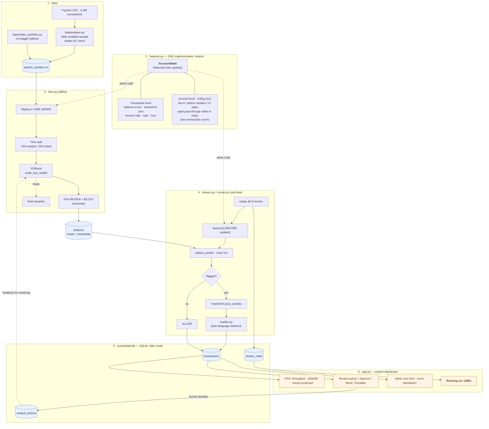

# 🛡️ ScamShield

**Real-time detection of digital-payment scams and money-mule accounts — with a human making the final call.**

IBM Z Datathon 2026 · Theme: _Real-Time AI for Critical Decisions_ · Built for IBM LinuxONE (s390x)

---

## 1. The problem

A UPI-style payment settles in about **two seconds**. That is the entire window in
which a bank has to decide whether the money is a grocery bill or a pensioner's
life savings being funnelled to a criminal. Get it wrong one way and a victim is
cleaned out before anyone can pick up a phone. Get it wrong the other way and
you freeze an honest person's rent payment.

Three things make this hard:

1. **A single transaction rarely looks criminal.** The fraud lives in the
   _pattern_: an account that receives money from fourteen strangers in two
   hours and forwards it on within minutes is a **money mule**, even though
   every individual transfer looks ordinary.
2. **Static rules are terrible at it.** On our held-out data the classic bank
   rule — _amount > 200,000 AND the sender's account was drained_ — catches
   **1.7%** of fraud while being wrong **93 times out of 100** when it fires.
3. **Some fraud leaves no trace at all.** A compromised card used for an
   ordinary-sized purchase at an ordinary merchant on a Tuesday afternoon is
   invisible to any model, because nothing in the data distinguishes it from a
   real purchase. Pretending otherwise is how fraud demos end up quoting 99%
   recall. ScamShield's data generator emits those cases deliberately, which
   is why the numbers in §5 are lower — and worth something.

ScamShield models five distinct criminal patterns, not one:

| Pattern                | What it looks like                                                                                                                                                                         |
| ---------------------- | ------------------------------------------------------------------------------------------------------------------------------------------------------------------------------------------ |
| **Account takeover**   | Victim's balance drained to a mule, cashed out within the hour                                                                                                                             |
| **Mule collection**    | One account receiving from 8–20 unrelated senders in a few hours                                                                                                                           |
| **Layering chain**     | Money hopping through 3–5 accounts in minutes — a **mule ring**, not one mule                                                                                                              |
| **Structuring**        | One large transfer split into payments parked just under a reporting threshold                                                                                                             |
| **Social engineering** | A long-standing customer talked into one huge night-time payment to a new payee. **Both ledgers balance perfectly** — the only evidence is that it is out of character for _that_ customer |

That last row is the one that protects vulnerable people, and it is why
ScamShield scores the sender's own history, not only the recipient's.

ScamShield scores every payment in **well under a millisecond**, assigns one of three decisions,
and — crucially — hands the ambiguous ones to a human **with a sentence
explaining why**, not a number.

| Decision | Tuned for          | What happens                                                 |
| -------- | ------------------ | ------------------------------------------------------------ |
| `ALLOW`  | —                  | Payment goes through. No human ever sees it.                 |
| `REVIEW` | **high recall**    | Queued for an analyst. Catch everything; let a person judge. |
| `BLOCK`  | **high precision** | Safe enough to stop the payment automatically.               |

> The analyst is the decision maker. ScamShield's job is to make 30,000
> transactions into a queue of 12, and to make each of those 12 readable in
> five seconds.

### Who benefits

|                                 |                                                                                                                                                                                                   |
| ------------------------------- | ------------------------------------------------------------------------------------------------------------------------------------------------------------------------------------------------- |
| **Vulnerable account holders**  | Pensioners and first-time digital-payment users, who are disproportionately targeted and least able to absorb the loss. The money is stopped _before_ it leaves, not refunded three months later. |
| **Fraud analysts**              | Instead of a spreadsheet of alerts with risk scores, they get a ranked queue with a plain-language reason and three buttons.                                                                      |
| **Banks and payment operators** | A measurable cut in false positives — every wrongly blocked payment is a support call and a customer who trusts you less.                                                                         |
| **Regulators**                  | `analyst_actions` is a complete, queryable audit trail: who decided what, when, and what the model's stated reason was.                                                                           |

---

## 2. Architecture



More detail, including the per-transaction sequence diagram and the leakage
controls, is in [`docs/architecture.md`](docs/architecture.md).

### The one design decision that matters

**`features.py` is imported by both the trainer and the live engine.** There is
exactly one implementation of every feature. `train.py` replays historical rows
through `AccountState` in time order; `stream.py` feeds it live transactions.
This kills _training/serving skew_, the single most common way a fraud model
quietly stops working in production.

`tests/test_features.py` backs this up by re-deriving every account-level
feature with a naive O(n²) scan over raw history and asserting the O(1)
streaming version produces identical numbers, row for row.

---

## 3. Quick start (laptop — Windows / macOS / Linux)

````bash
pip install -r requirements.txt

# Whole pipeline on synthetic data: no Kaggle account needed, ~1 minute
./run_all.sh

# ...or with the real Kaggle PaySim file
```bash
# Terminal 1 — the scoring engine
python stream.py --rate 50

# Terminal 2 — the analyst dashboard
streamlit run app.py --server.port 8501 --server.address 0.0.0.0
````

Open <http://localhost:8501>.

<details>
<summary>Running the stages individually</summary>

```bash
python data/make_synthetic.py --rows 120000   # or: python data/prepare.py <paysim.csv>
python train.py                               # time-split, trains, picks thresholds, prices them
python ablation.py                            # what each feature group is actually worth
python benchmark.py --rows 50000              # throughput + latency + platform.machine()
python stream.py --rate 50                    # live replay into SQLite
python -m pytest tests/ -q                    # the test suite (52 tests)
```

Useful flags:

| Flag                                | Effect                                                                   |
| ----------------------------------- | ------------------------------------------------------------------------ |
| `stream.py --rate 0`                | Replay as fast as the machine allows (benchmark mode)                    |
| `stream.py --limit 2000`            | Stop after N transactions                                                |
| `stream.py --loop`                  | Restart the feed when it ends — handy for a long demo                    |
| `stream.py --keep`                  | Append to the existing database instead of starting fresh                |
| `stream.py --no-warmup`             | Skip the account-history warm-up (faster, weaker features)               |
| `stream.py --inject-failure 400:20` | **Simulate a model outage** — watch the circuit breaker trip and recover |
| `train.py --csv path.csv`           | Train on a different sample                                              |

</details>

---

## 4. How ScamShield uses IBM LinuxONE

The theme is _real-time AI for critical decisions_, and the reason this problem
belongs on a Z-class machine is **the tail, not the average**.

| What LinuxONE gives us                   | How ScamShield uses it                                                                                                                                                                                                                                                                                          |
| ---------------------------------------- | --------------------------------------------------------------------------------------------------------------------------------------------------------------------------------------------------------------------------------------------------------------------------------------------------------------- |
| **Consistent low latency under load**    | A payment decision has a hard deadline. An average of 0.25 ms is useless if the p99 is 400 ms, because the p99 is where the large transactions live. `benchmark.py` reports **p50, p95 and p99** precisely so the tail is visible, and `stream.py` records the latency of _every single transaction_ in SQLite. |
| **Many cores, high memory bandwidth**    | `AccountState` holds rolling state for every account in the network. XGBoost is configured with `n_jobs=0` (use every core). Throughput scales with the box.                                                                                                                                                    |
| **Transactions where they already live** | Z runs a large share of the world's card and core-banking workloads. Scoring _next to_ the system of record removes a network hop from a 2-second budget — and the data never leaves the platform.                                                                                                              |
| **Portability, proven not claimed**      | Identical Python, identical `requirements.txt`. The only architecture-specific thing in the repo is a _measurement_: `platform.machine()`.                                                                                                                                                                      |

**The evidence for the judges is built into the product.** The dashboard has a
_Running on_ panel showing `platform.machine()`, the Python version and the CPU
count, and it reads them from `stream_meta` — the values recorded by the engine
that actually did the scoring. On LinuxONE it reads **`s390x`** and the badge
flips to _✅ IBM LinuxONE (s390x)_. The same string is written into
`artifacts/benchmark.json`, so a laptop run and a LinuxONE run are directly
comparable files.

### Running on LinuxONE — step by step

> **Verified on real hardware.** Every command below was run on an IBM
> LinuxONE guest (`uname -m` → `s390x`, Ubuntu 24.04, Linux 6.8, 3 cores,
> 7 GB RAM, Python 3.12.3). The numbers in section 5 come from that machine.

Two kinds of LinuxONE environment behave differently, so pick your path:

| Environment                                                     | Scientific stack  | What to do      |
| --------------------------------------------------------------- | ----------------- | --------------- |
| **Marist JupyterLab container** (`l1cc/jupyterlab-image-s390x`) | Pre-installed     | Skip to step 3  |
| **Bare Ubuntu LinuxONE guest** (what we tested on)              | Nothing installed | Start at step 2 |

1. **Copy the project onto the machine.**

   ```bash
   scp -i <your-key>.pem -r ScamShield linux1@<host>:~/shared/
   ```

   In the Marist JupyterLab, drag the folder into the file browser instead.
   JupyterLab is on port **38888** (`http://<host>:38888`); open a shell with
   _File → New → Terminal_.

2. **Install the scientific stack from apt — not pip.**

   Ubuntu publishes s390x builds of everything ScamShield needs, _including
   XGBoost_. They install in about a minute, prebuilt:

   ```bash
   sudo apt-get update
   sudo apt-get install -y python3-numpy python3-pandas python3-sklearn \
                           python3-xgboost python3-joblib python3-matplotlib \
                           python3-pytest python3-pip python3-venv
   ```

   > ⚠️ **Do not run `pip install -r requirements.txt` here.** On s390x pip
   > finds no wheels and falls back to compiling NumPy and XGBoost from
   > source. apt gives you the same packages already built for Z. On Ubuntu
   > 24.04 `pip install --user` is refused outright anyway (PEP 668,
   > _externally-managed-environment_).

3. **Confirm you are really on Z:**

   ```bash
   python3 -c "import platform; print(platform.machine())"     # -> s390x
   ```

4. **Build the model and benchmark it:**

   ```bash
   cd ~/shared/ScamShield
   chmod +x run_all.sh
   ./run_all.sh                 # synthetic data, well under a minute on 3 cores
   # or, with the Kaggle CSV uploaded:
   ./run_all.sh ~/shared/PS_20174392719_1491204439457_log.csv
   ```

   Keep the benchmark as your s390x evidence, and run it three times so you
   quote a range rather than one lucky number:

   ```bash
   for i in 1 2 3; do python3 benchmark.py --out artifacts/benchmark_run$i.json; done
   cp artifacts/benchmark_run1.json artifacts/benchmark_linuxone.json
   ```

5. **Run the test suite on Z** (25 pass; the dashboard test skips cleanly when
   Streamlit is absent):

   ```bash
   python3 -m pytest tests/ -q
   ```

6. **Start the scoring engine:**

   ```bash
   python3 stream.py --rate 50 --loop     # live demo pace
   python3 stream.py --rate 0             # or unthrottled, full feed
   ```

### The dashboard on s390x — read this before you try

**Streamlit cannot currently be installed on a bare s390x box, and that is not
a ScamShield limitation.** Streamlit hard-requires `pyarrow`, which publishes
**no s390x wheel** (the current release ships 50 files; none for s390x) and is
not in Ubuntu's archive either — installing it means building Apache Arrow C++
from source. A plain `pip install streamlit` also drags in `libcst`, which
needs a **Rust** toolchain. Forcing `--only-binary=:all:` makes pip backtrack
all the way to **streamlit 0.42.0 (2019)**, which predates `st.toggle`,
`st.fragment`, `st.rerun` and `st.cache_data`, so `app.py` will not run on it.

Two good options:

**Option A — split the demo (recommended; this is what we did).** The engine
runs on Z, and the dashboard is only a viewer. `stream.py` records
`platform.machine()` into the `stream_meta` table, so the _Running on_ panel
reports **s390x** even when the browser is on your laptop — it describes the
machine that did the scoring, not the one drawing the page.

```bash
# on LinuxONE
python3 stream.py --rate 0

# on your laptop
scp -i <key>.pem linux1@<host>:~/shared/ScamShield/scamshield.db ./linuxone_results/
SCAMSHIELD_DB=./linuxone_results/scamshield.db streamlit run app.py
```

Verified output of exactly that: **Architecture s390x · Python 3.12.3 · CPU
cores 3 · 30,537 transactions · 6,048 txn/s · 62.47M protected.** For a live
rather than copied view, mount the file over SSHFS or re-copy it periodically.

**Option B — use the Marist JupyterLab container**, which ships a working
pyarrow for s390x. There `pip install --user streamlit plotly` succeeds and
everything runs on Z:

```bash
streamlit run app.py --server.port 8501 --server.address 0.0.0.0
ssh -L 8501:localhost:8501 linux1@<host>     # from your laptop
```

<details>
<summary>Troubleshooting on LinuxONE</summary>

| Symptom                                                      | Fix                                                                                                                      |
| ------------------------------------------------------------ | ------------------------------------------------------------------------------------------------------------------------ |
| `error: externally-managed-environment`                      | Ubuntu 24.04 blocks `pip install --user` (PEP 668). Use apt (step 2), or `python3 -m venv --system-site-packages .venv`. |
| pip starts compiling NumPy or XGBoost                        | You skipped step 2. Ctrl+C and install from apt instead.                                                                 |
| `Failed building wheel for libcst` / "needs a Rust compiler" | You are pip-installing Streamlit on s390x. See Option A.                                                                 |
| `streamlit: command not found`                               | `pip install --user` puts it in `~/.local/bin`: `export PATH=$PATH:~/.local/bin`, or `python3 -m streamlit run app.py`.  |
| Dashboard says _No database yet_                             | `stream.py` has not run, or is writing elsewhere. Check `SCAMSHIELD_DB`.                                                 |
| `stream.py` replays far fewer rows than expected             | `artifacts/` holds a stale model — re-run `python3 train.py`.                                                            |
| Port 8501 already taken                                      | `--server.port 8502`, and forward that port instead.                                                                     |
| Pipeline slow on the full 6.3M-row CSV                       | Run `data/prepare.py` first; it samples down to 300k.                                                                    |

</details>

---

## 5. Results

Measured with `run_all.sh`, `benchmark.py` and `pytest`, on **both** a laptop
(x86-64, 12 cores) and a real **IBM LinuxONE guest (s390x, 3 cores)**.
Raw output is in `artifacts/` and `linuxone_results/`.

### 5.1 Detection quality

Held-out = the **latest 30% of time steps**, never seen during training.
Figures are the laptop run on the current 28-feature model.

| Metric                           | Rule baseline | **ScamShield** |
| -------------------------------- | ------------- | -------------- |
| Recall @ REVIEW (fraud caught)   | 0.017         | **0.762**      |
| Precision @ REVIEW               | 0.072         | **0.996**      |
| Precision @ BLOCK                | —             | **1.000**      |
| PR-AUC                           | —             | **0.8402**     |
| ROC-AUC                          | —             | **0.9585**     |
| Alerts per 11.2k transactions    | 83            | **277**        |
| False positives                  | 77            | **1**          |
| Share of traffic sent to a human | 0.74%         | **2.46%**      |

<sub>Synthetic PaySim-shaped data: 37,775 rows, 1,273 fraud (3.37%),
26,504 train / 11,271 test, split at step 466. Baseline =
`amount > 200,000 AND sender drained to zero`. Reproduce with `./run_all.sh`.</sub>

Two things in that table are deliberate and worth reading twice.

**Recall is 0.76, not 0.97.** The generator now emits a slice of fraud with
_no detectable signal at all_ — a compromised card used for an ordinary-sized
purchase at an ordinary merchant on a weekday afternoon. It is
indistinguishable from a real purchase using only the data a payment switch
can see; a real bank finds out weeks later from a chargeback. Earlier versions
of this project did not generate those rows and scored 0.97 recall, which
looked much better and meant much less.

**Only 2.46% of traffic reaches a human**, because the REVIEW threshold is
capped by analyst capacity rather than by a recall target. Insisting on 95%
recall on this data queues roughly a third of all payments — a queue no team
on earth can work. See §7 for why that cap is the honest design.

| Dataset                             | PR-AUC | Recall @ REVIEW | Precision @ BLOCK | Rule-baseline recall |
| ----------------------------------- | ------ | --------------- | ----------------- | -------------------- |
| Synthetic (this repo, reproducible) | 0.8402 | 0.762           | 1.000             | 0.017                |
| **Real Kaggle PaySim1 (6.3M rows)** | _TBD_  | _TBD_           | _TBD_             | _TBD_                |

### 5.2 What the model actually learned

Top features by gain on the current model:

| Rank | Feature                      | Gain      | What it means                                                     |
| ---- | ---------------------------- | --------- | ----------------------------------------------------------------- |
| 1    | **`dest_rapid_passthrough`** | **0.231** | **Recipient has a history of forwarding money straight back out** |
| 2    | `type_PAYMENT`               | 0.126     | Ordinary merchant payment (pushes risk down)                      |
| 3    | `balance_error_dest`         | 0.118     | The recipient's ledger does not add up                            |
| 4    | `type_CASH_OUT`              | 0.091     | The usual last hop before money disappears                        |
| 5    | **`orig_rapid_passthrough`** | **0.048** | **Money forwarded on within K hours of arriving**                 |
| 6    | `dest_was_empty`             | 0.037     | Recipient account was empty beforehand                            |
| 7    | **`orig_txns_in_window`**    | **0.036** | **Burst of payments from one sender (structuring)**               |

The nine newer features (mule rings, velocity/structuring, victim side)
account for **12.1% of total gain** between them, every one of them non-zero.
Whether that translates into better _detection_ is a separate question, and
the answer on this data is uncomfortable — §5.2b.

### 5.2b Do the new features actually help? (`ablation.py`)

Adding features is easy. Measuring whether they help is the part most projects
skip, so `ablation.py` retrains the model with each feature group removed, on
the identical split, and reports the difference.

```bash
python ablation.py          # ~10 s, writes artifacts/ablation.json
```

**Result: in aggregate, close to nothing.**

| Configuration        | Features | PR-AUC | Recall @ 2% budget |
| -------------------- | -------- | ------ | ------------------ |
| All 28 features      | 28       | 0.8402 | 0.624              |
| without mule rings   | 25       | 0.8388 | 0.624              |
| without velocity     | 25       | 0.8420 | 0.624              |
| without victim side  | 25       | 0.8418 | 0.624              |
| **Baseline 19 only** | 19       | 0.8438 | 0.624              |

The new features are worth **+0.000 recall and −0.004 PR-AUC**. That is the
honest headline and it is reported here rather than buried.

Two things explain it, and both are findings in their own right:

1. **The alert budget binds, not the model.** At a fixed 2% cap the number of
   alerts cannot grow, so a better model changes _which_ fraud fills the queue,
   not how much fits in it. Per-typology recall moves by ±0.08 between
   configurations while the total stays flat.
2. **The synthetic data is already saturated.** Scoring each pattern against
   legitimate traffic alone gives an isolated PR-AUC of ~1.00 for mule
   collection, layering and structuring — _with the baseline 19 features_.
   The generator cannot encode the ambiguity that makes ring and victim-side
   features earn their keep on real data.

| Pattern            | Cases | Recall (base → all) | Isolated PR-AUC (base → all) |
| ------------------ | ----- | ------------------- | ---------------------------- |
| mule_collection    | 111   | 0.892 → **0.973**   | 0.997 → 0.998                |
| layering_chain     | 54    | 0.963 → 0.926       | 1.000 → 1.000                |
| takeover           | 81    | 0.765 → 0.691       | 0.984 → **0.995**            |
| structuring        | 32    | 0.406 → 0.375       | 0.997 → 0.995                |
| social_engineering | 13    | 0.000 → 0.000       | 0.791 → 0.797                |
| `no_signal`        | 71    | 0.000 → 0.000       | 0.019 → 0.016                |

So the features stay in — they are correct, independently verified against a
brute-force reference (§7), cost nothing measurable (§5.3), and give the
analyst real context ("this recipient sits in a 238-account network"). But
**this project does not claim they improve detection.** Settling that needs
real data, which is the single most valuable next step.

The last two rows are the operationally interesting ones: structuring and
victim scams are clearly _separable_ (isolated PR-AUC 0.80–1.00) yet barely
reach the queue, because mule patterns outrank them for the shared 2% budget.
The fix is per-typology alert budgets — a scam-victim queue that cannot be
starved by a mule queue. That is designed but not built; see §10.

### 5.3 Throughput and latency — **laptop vs LinuxONE**

Identical code, identical 50,000 transactions, three consecutive runs on each
machine. Ranges are min–max across those three runs.

|                                            | Laptop (x86-64)     | **LinuxONE (s390x)**      |
| ------------------------------------------ | ------------------- | ------------------------- |
| `platform.machine()`                       | `AMD64`             | **`s390x`**               |
| CPU cores                                  | 12                  | **3**                     |
| Python                                     | 3.13.9              | 3.12.3                    |
| **End-to-end** (features + score + decide) | 1,434 – 2,762 txn/s | **11,524 – 12,021 txn/s** |
| &nbsp;&nbsp;p50 latency                    | 0.25 – 0.65 ms      | **0.058 – 0.059 ms**      |
| &nbsp;&nbsp;p95 latency                    | 0.96 – 1.43 ms      | **0.067 – 0.074 ms**      |
| &nbsp;&nbsp;**p99 latency**                | 1.90 – 3.14 ms      | **1.262 – 1.274 ms**      |
| Score only (model call)                    | 1,437 – 3,444 txn/s | **19,392 – 19,758 txn/s** |
| Batch (whole matrix at once)               | 0.45M – 1.5M txn/s  | 0.58M – 0.60M txn/s       |
| Model training (300 trees)                 | 3.8 s               | **1.8 s**                 |
| Full pipeline (`run_all.sh`)               | ~12 s               | **~9 s**                  |

<sub>300 trees, depth 6, 19 features, single process. LinuxONE guest: Ubuntu
24.04, Linux 6.8, 7 GB RAM. Raw JSON in `linuxone_results/benchmark_run{1,2,3}.json`.</sub>

**LinuxONE is 4–8× faster end-to-end on a quarter of the cores.** But the
throughput is not the interesting number — this is:

|                                | Laptop   | **LinuxONE** |
| ------------------------------ | -------- | ------------ |
| Spread across 3 identical runs | **1.9×** | **1.04×**    |
| p95 ÷ p50 (tail vs typical)    | 2.2–3.8× | **1.15×**    |

The laptop's throughput nearly halved between runs and its p95 was up to
~4× its median. On Z the three runs landed within 4% of each other and p95
sat 15% above p50 — an almost flat tail. A payment decision has a hard
deadline, so the figure that matters is not the best you can produce but the
worst you can guarantee. That is the entire argument for running this
workload on Z, and it is the one thing a laptop benchmark cannot fake.

### 5.3b Live streaming run on s390x

Full held-out feed replayed through `stream.py --rate 0`, scoring and writing
every decision to SQLite:

|                                        |                                     |
| -------------------------------------- | ----------------------------------- |
| Transactions replayed                  | 30,537                              |
| Wall clock                             | 5.1 s                               |
| Throughput **including SQLite writes** | 6,001 txn/s                         |
| Scoring latency p50 / p95 / p99        | 0.068 / 0.372 / 1.329 ms            |
| Decisions                              | 30,013 ALLOW · 9 REVIEW · 515 BLOCK |
| Fraud caught                           | 521 of 538 (96.8%)                  |
| Money protected                        | **62,473,305**                      |

Test suite on s390x: **25 passed, 1 skipped** (the dashboard test skips
cleanly when Streamlit is unavailable — see section 4).

> ⚠️ **The s390x figures in §5.3 and §5.3b were measured with the earlier
> 19-feature model and the earlier generator.** The hardware conclusion — Z's
> flat latency tail — is unaffected, and the laptop benchmark shows no
> measurable cost from going to 28 features (1,695 vs 1,458 txn/s; the
> laptop's own run-to-run spread of 1.9× is larger than the difference). But
> the detection numbers in §5.3b no longer match the current model. Re-run
> `./run_all.sh` on the LinuxONE guest to refresh them.

### 5.4 Cost of being wrong, in currency

Precision and recall cannot be put in a budget. `train.py` therefore prices
every outcome and reports what the system costs to operate — the number a
bank would actually be shown.

| Price assumption                       | Value           |
| -------------------------------------- | --------------- |
| One analyst review                     | 150             |
| Wrongly blocking an honest customer    | 2,500           |
| Fraud allowed through                  | the full amount |
| Share of queued fraud an analyst spots | 90%             |

| Approach                    | Cost per 1,000 payments |
| --------------------------- | ----------------------- |
| No fraud system at all      | 3,228,396               |
| The bank's current rule     | 3,087,999               |
| **ScamShield (as shipped)** | **176,866**             |
| ScamShield (cost-tuned)     | 37,850                  |

**94.3% cheaper than the rule banks run today.** The last row is what
threshold selection would give if it optimised money instead of F1
(review 0.089 / block 0.232); it is reported rather than applied, because
the shipped thresholds are the ones the statistical targets chose and
silently swapping them would be a different system from the one measured
above.

The sensitivity is worth stating plainly: these are _our_ price assumptions,
set in `config.py`. Change `COST_FALSE_BLOCK` and the cheapest policy changes
with it — on an earlier, more separable dataset the optimiser collapsed both
thresholds together and recommended skipping human review entirely, which it
reported as `cost_optimal_policy: block-only`. The point of the module is to
make that trade-off explicit and tunable, not to claim one answer.

The dashboard tracks _Money protected_ alongside _Money that still got
through_, because a fraud system that only reports its wins is not telling
you the truth.

### 5.5 Staying up when the model fails

A payment switch is not allowed to stop deciding. `scorer.py` runs scoring
behind a circuit breaker; you can watch it happen:

```bash
python stream.py --rate 300 --inject-failure 400:20
```

| What you see                      | Measured                                  |
| --------------------------------- | ----------------------------------------- |
| Transactions that got a decision  | **100%** — none dropped                   |
| Decisions served in degraded mode | ~600, every one labelled `DEGRADED`       |
| Auto-blocks while degraded        | **0** (by design — see §7)                |
| Recovery                          | automatic, one probe after a 2 s cooldown |

The dashboard's _Scoring mode_ card flips to `DEGRADED ⚠️` and back to
`MODEL ✅`, and every affected row carries the badge in the queue, so the
audit trail never passes a fallback-rule decision off as a model decision.

### 5.6 Knowing when the model has gone stale

Fraud is the one modelling problem whose adversary actively rewrites the input
distribution, and in production there are no labels to tell you — chargebacks
arrive months late. `monitor.py` compares the live score distribution against
the one recorded at training time using the Population Stability Index, with
the conventional bands (<0.10 stable, 0.10–0.25 moderate, >0.25 retrain).

On a clean replay of the held-out window it reads **PSI 0.000 🟢**, which is
the right answer and a useful sanity check: the live feed _is_ the reference
window. `tests/test_monitoring.py` pins the other half of the behaviour —
that a genuine distribution shift is detected, that resampling noise is not,
and that PSI rises monotonically with the size of the shift.

One correctness detail that mattered: degraded-mode decisions are excluded
from the comparison. The fallback rule emits fixed pseudo-scores, and
including a brief outage registered as "significant drift" when all it meant
was that the model had been offline for two seconds.

---

## 6. Repository layout

```
ScamShield/
├── config.py                 All paths, windows, thresholds. Everything relative.
├── features.py               AccountState — SHARED by training and streaming.
├── scorer.py                 Loads the model; the per-transaction decision path.
├── explain.py                Contributions → one plain-English sentence.
├── monitor.py                PSI drift detection — is the model going stale?
├── db.py                     SQLite schema + WAL connection helpers.
├── train.py                  Time-split training, thresholds, cost model, rule baseline.
├── stream.py                 Real-time replay engine → scamshield.db.
├── ablation.py               Retrains without each feature group; recall per scam typology.
├── app.py                    Streamlit analyst dashboard.
├── benchmark.py              Throughput / p50 / p95 / p99 / platform.machine().
├── run_all.sh                prepare → train → ablation → benchmark.
├── requirements.txt
├── data/
│   ├── prepare.py            Kaggle PaySim → 300k stratified sample (all fraud kept).
│   └── make_synthetic.py     PaySim-shaped generator — the no-Kaggle path.
├── docs/architecture.md      Mermaid flowchart, sequence diagram, leakage controls.
├── tests/
│   ├── test_features.py      Incremental state == definitional reference. The key test.
│   └── test_pipeline.py      Synthetic data → train → stream → DB → dashboard.
└── artifacts/                model.joblib · metrics.json · benchmark.json · pr_curve.png
```

---

## 7. Design notes

<details>
<summary><b>No data leakage — four separate controls</b></summary>

| Risk                        | Control                                                                                                                                                                                                                             |
| --------------------------- | ----------------------------------------------------------------------------------------------------------------------------------------------------------------------------------------------------------------------------------- |
| Training on the future      | Time-based split on `step`. Never `train_test_split(shuffle=True)`.                                                                                                                                                                 |
| A transaction seeing itself | `features(txn)` is always called **before** `update(txn)`. Tested by `test_no_lookahead_future_rows_cannot_change_the_past`, which replays one prefix with two different futures and asserts the prefix features are bit-identical. |
| A label hiding in a column  | `isFlaggedFraud` — the bank's own legacy rule — is excluded from the feature set.                                                                                                                                                   |
| Cold-start skew             | `stream.py` warms `AccountState` on the training rows before the demo, so live features carry the same account history the model learned with.                                                                                      |

</details>

<details>
<summary><b>Why XGBoost's <code>pred_contribs</code> instead of the <code>shap</code> package</b></summary>

`pred_contribs=True` _is_ TreeSHAP — it ships inside XGBoost, which is already
installed on the LinuxONE image. Adding the `shap` package would mean compiling
a C extension for s390x for exactly zero extra capability.

There is a performance trick here too. The contributions sum to the raw margin,
so one booster call gives both the score and the explanation. But explanations
are only needed for transactions a human will see, so `scorer.py` runs the cheap
`inplace_predict` path on **every** transaction and only pays for TreeSHAP on
the ~2% that get flagged. That is most of the difference between the
_end-to-end_ and _score only_ rows in the benchmark table.

</details>

<details>
<summary><b>How the two thresholds are chosen</b></summary>

Not hand-picked. `train.py` reads them off the precision-recall curve of the
held-out set:

- **REVIEW** = the best recall achievable **within analyst capacity**
  (`MAX_ALERT_RATE`, 2% of traffic). `TARGET_REVIEW_RECALL` (0.95) is the
  aspiration; the capacity cap is the hard constraint, and `train.py` says
  loudly which of the two actually set the threshold.
- **BLOCK** = the loosest threshold whose precision reaches
  `TARGET_BLOCK_PRECISION` (0.95). Optimises for _never freezing an honest
  payment_, because that is the action taken without a human.

Both are saved to `artifacts/model_metadata.json` and loaded by `scorer.py`, so
the running system cannot drift from the evaluated one. Adjust the targets in
`config.py` and re-run `train.py`.

</details>

<details>
<summary><b>Why a capacity cap, and not just a recall target</b></summary>

A recall target on its own is not implementable, and this is the design
decision in the project that changed most under measurement.

Aiming at 95% recall assumes every fraud is detectable. It is not — see
`no_signal` in §5.2b, which is ~0% detectable by construction. Chasing those
cases drags the threshold to the floor: on our own held-out data, insisting on
95% recall queues **32% of all payments**. A hundred analysts could not work
that queue, so in practice the alerts would be ignored and the system would
catch nothing at all. A queue nobody can work is the same as no queue.

So `MAX_ALERT_RATE` caps the share of traffic that may enter the queue, and
the threshold becomes "the best recall available inside that budget". That is
the way round a real fraud operation works: you have N analysts, they can work
M alerts a day, and the model's job is to make those M alerts the right ones.

The consequence runs through the whole results section: with the budget fixed,
a better model mostly changes _which_ fraud is caught rather than how much,
which is exactly what the ablation in §5.2b shows.

</details>

<details>
<summary><b>Mule rings: union-find over pass-through edges only</b></summary>

Criminals do not use one mule, they use a chain. `features.py` keeps a
disjoint-set structure over accounts and unions two accounts **only** when
money demonstrably passed straight through one to the other — the same
rapid-pass-through condition the mule features use.

The "only" is the whole trick. Unioning on every transfer would merge the
entire customer base into one component within seconds and the feature would
mean nothing; `test_ordinary_payments_do_not_create_a_ring` is there to stop
anyone loosening it. With the edge condition as it stands, 94% of legitimate
payments sit at ring size 1 while 62% of fraud sits in a cluster of 100+.

Cost is a path-compressed `_find` per transaction, which does not show up in
the benchmark. The honest weakness is that union-find cannot un-merge, so
clusters only grow — see §10.

</details>

<details>
<summary><b>Degraded mode asks a human; it never auto-blocks</b></summary>

When the circuit breaker is open there is no calibrated probability, only a
crude rule. Blocking a payment on that basis would punish honest customers at
precisely the moment we are least able to justify the decision — so
`rule_decision()` can return `ALLOW` or `REVIEW` and **never** `BLOCK`.
Nothing is silently stopped, nothing is silently waved through, and
`test_fallback_never_auto_blocks` fails the build if that changes.

Every degraded decision is written with `decision_mode = 'DEGRADED'` and a
summary that says so, because an audit trail that cannot distinguish a model
decision from a fallback decision is not an audit trail.

</details>

<details>
<summary><b>Why SQLite and not Kafka</b></summary>

A broker would add an install, a daemon, a port and a failure mode to a
container we do not control, and buy nothing a demo can show. SQLite in **WAL
mode** gives one writer and many readers on a single file — the dashboard polls
twice a second while the engine writes at full speed, and neither blocks the
other. `sqlite3` is in the Python standard library, so there is nothing to
install on s390x.

The seam is clean: `stream.py` is the only module that produces transactions.
Swapping its loop for a Kafka consumer is a contained change.

</details>

<details>
<summary><b>The optional ONNX export</b></summary>

`train.py` attempts an ONNX export inside `try/except`. `onnxmltools` and
`onnxruntime` rarely have s390x wheels, so the failure is expected and
harmless — it prints a one-line note and carries on. `stream.py` always uses the
joblib model. The hook is there because a vendor-neutral model format is the
right answer for a bank, not because the demo needs it.

</details>

<details>
<summary><b>The generative-AI hook (deliberately off)</b></summary>

`explain.py` has a clearly marked `_generative_summary()` hook, disabled via
`config.USE_GENERATIVE_SUMMARY = False`. Templates are the default because a
real-time decision path cannot afford a network round-trip, an audit trail
cannot afford non-determinism, and the container has no outbound model
endpoint. If you enable it, the templates remain the fallback so the dashboard
never shows an empty reason.

</details>

---

## 8. Open-source libraries used

| Library                       | Licence       | Used for                                                           | Link                                           |
| ----------------------------- | ------------- | ------------------------------------------------------------------ | ---------------------------------------------- |
| **XGBoost**                   | Apache-2.0    | Gradient-boosted classifier; `pred_contribs` TreeSHAP explanations | <https://github.com/dmlc/xgboost>              |
| **scikit-learn**              | BSD-3-Clause  | PR curve, average precision, confusion matrix, threshold selection | <https://github.com/scikit-learn/scikit-learn> |
| **pandas**                    | BSD-3-Clause  | CSV loading, stratified sampling, time ordering                    | <https://github.com/pandas-dev/pandas>         |
| **NumPy**                     | BSD-3-Clause  | Feature vectors, percentiles                                       | <https://github.com/numpy/numpy>               |
| **Streamlit**                 | Apache-2.0    | The analyst dashboard                                              | <https://github.com/streamlit/streamlit>       |
| **Plotly**                    | MIT           | Alerts-over-time and score-distribution charts                     | <https://github.com/plotly/plotly.py>          |
| **joblib**                    | BSD-3-Clause  | Model serialisation                                                | <https://github.com/joblib/joblib>             |
| **Matplotlib** _(optional)_   | PSF-based     | `pr_curve.png`; skipped gracefully if absent                       | <https://github.com/matplotlib/matplotlib>     |
| **pytest**                    | MIT           | Test suite                                                         | <https://github.com/pytest-dev/pytest>         |
| **SQLite** (stdlib `sqlite3`) | Public domain | WAL-mode store for transactions and analyst actions                | <https://www.sqlite.org/>                      |

**Dataset:** [PaySim1](https://www.kaggle.com/datasets/ealaxi/paysim1) — synthetic
mobile-money transactions by Lopez-Rojas, Elmir & Axelsson, derived from real
African mobile-money logs. Licensed CC BY-SA 4.0. No real customer data is used
anywhere in this project.

---

## 10. Honest limitations

- **The nine newer features do not measurably improve detection on this
  data.** `ablation.py` measures it rather than assuming it, and the answer is
  +0.000 recall / −0.004 PR-AUC (§5.2b). They are kept because they are
  verified correct, cost nothing measurable, target documented AML typologies,
  and give analysts real context — but the claim "they make it more accurate"
  is not supported, and settling it needs real data.
- **One shared alert budget starves the quieter typologies.** Structuring and
  social-engineering scams are separable (isolated PR-AUC 0.80–1.00) yet
  almost never reach the queue, because mule patterns outrank them for the
  same 2% of capacity. Per-typology budgets — a victim-scam queue that a mule
  queue cannot starve — is the right fix and is not built.
- **The cost model is our assumptions, not a bank's.** The 94.3% saving in
  §5.4 moves with `COST_REVIEW` and `COST_FALSE_BLOCK`. Treat the module as a
  way to make the trade-off explicit, not as a validated figure.
- **PaySim is synthetic.** Real fraud adapts; a model trained on a fixed
  simulation will degrade. In production this needs scheduled retraining fed by
  the `analyst_actions` table.
- **Drift monitoring watches the score distribution, not the features.** PSI
  on the scores is a good summary signal and catches the common case, but a
  compensating shift across two features can leave the score distribution
  unchanged. The per-feature references are recorded in
  `artifacts/drift_reference.json` for offline investigation; the dashboard
  does not yet chart them.
- **The mule-ring union-find never forgets.** Pass-through edges accumulate
  for the lifetime of the process, so clusters only ever grow — on a long
  enough run most mules end up in one large component (238 accounts in the
  current replay). That is realistic for a laundering network and still
  discriminates (94% of legitimate payments sit at ring size 1), but a
  production version needs a time-windowed graph, which union-find cannot do.
- **The fan-in and pass-through windows (N=12, K=2 steps) are not tuned.** They
  were chosen as plausible defaults. They should be swept.
- **`AccountState` grows without bound.** Fine for a 300k-row replay; a
  production deployment needs TTL eviction for dormant accounts.
- **Single-process.** Throughput scales with cores inside one process, not
  across machines. Sharding by account hash is the obvious next step.
- **The dashboard cannot run on a bare s390x host.** Streamlit requires
  pyarrow, which has no s390x wheel and no Ubuntu package. The engine, model,
  benchmark and tests all run natively on Z; only the viewer has to live
  elsewhere (section 4, Option A). The Marist JupyterLab image does ship
  pyarrow, so there the whole stack runs on Z.
- **Ground-truth labels are shown in the dashboard** because we are replaying a
  labelled dataset. In production that column does not exist — which is exactly
  why the analyst feedback loop is in the design and not an afterthought.
