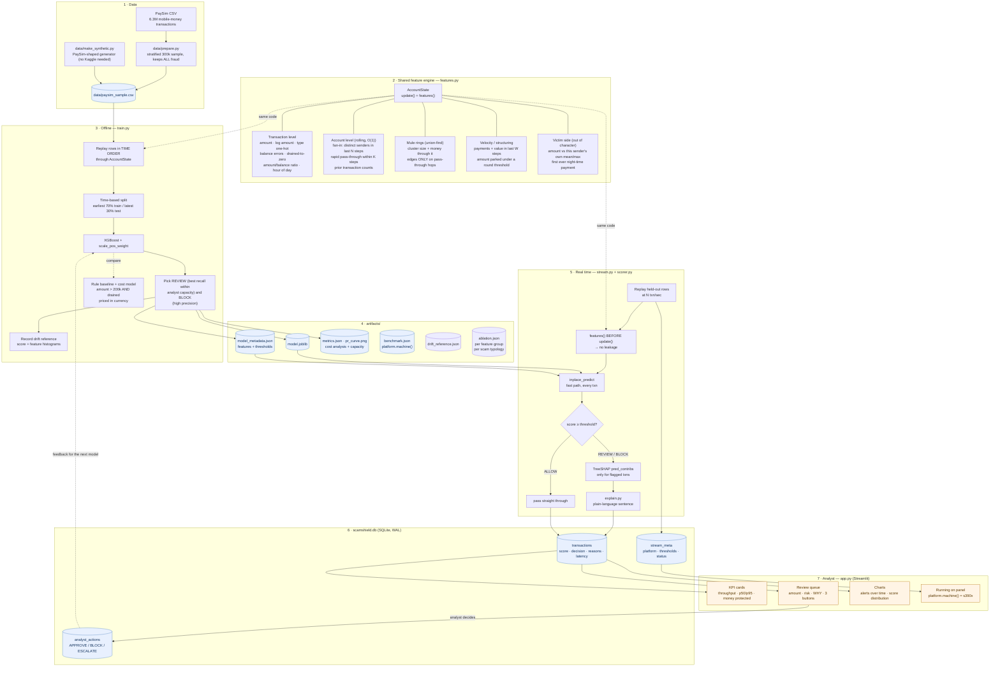
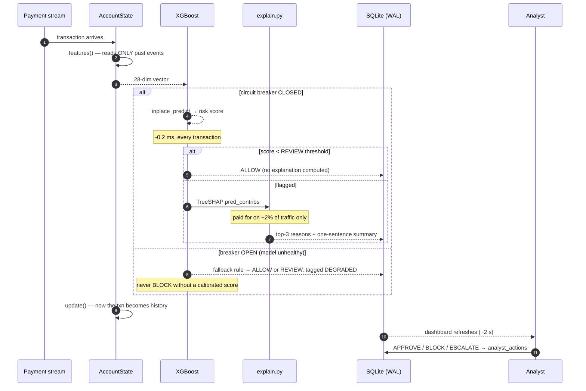
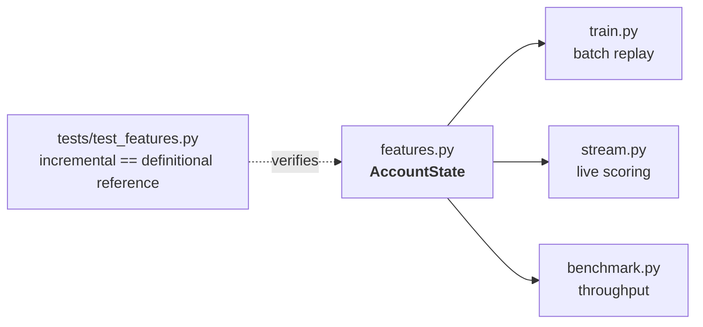
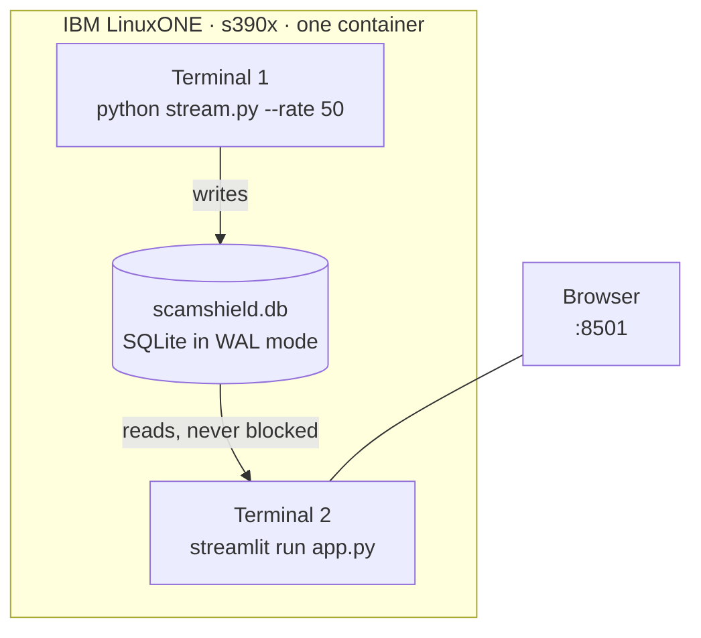
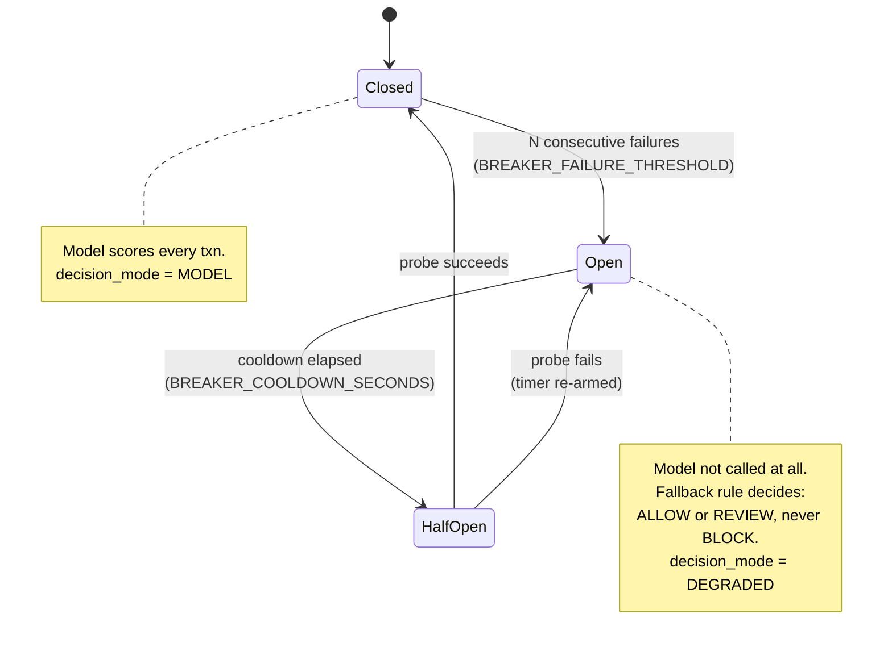
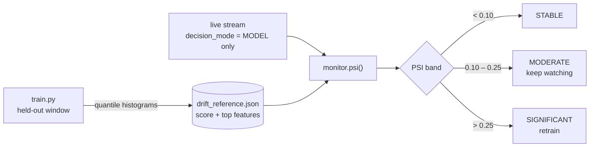

# ScamShield - architecture

## 1. End-to-end flow

## 2. The critical decision path (per transaction)

## 3. Why the feature code is shared

The most common way a fraud model dies in production is **training/serving
skew**: features computed one way in a notebook and another way in the live
system. ScamShield makes that structurally impossible.

There is exactly one implementation. `train.py` replays historical rows
through it in time order; `stream.py` feeds it live transactions. The test
suite re-derives every account-level feature with a naive O(n²) scan over raw
history and asserts the O(1) streaming version produces identical numbers.

## 4. Leakage controls

| Risk | Control |
|---|---|
| Future data in training | Time-based split; train on earliest 70% of steps, test on the rest. Never `train_test_split(shuffle=True)`. |
| A transaction seeing itself | `features(txn)` is called **before** `update(txn)`, always. Enforced by `AccountState.process()` and tested by `test_no_lookahead_future_rows_cannot_change_the_past`. |
| Label leaking through a column | `isFlaggedFraud` (the bank's own legacy rule) is excluded from the feature set. |
| Cold-start mismatch | `stream.py` warms `AccountState` on the training rows first, so live features have the same account history the model trained with. |

## 5. Runtime shape on IBM LinuxONE

Two processes, one file, no message broker and no database server. WAL mode
is what makes the single file safe for a concurrent writer and reader — which
is why the dashboard stays live while the engine is at full throughput.

## 6. Resilience: the state machine behind every decision

A payment switch must answer every transaction inside its deadline, including
while the model is misbehaving. `scorer.py` therefore wraps scoring in a
three-state circuit breaker, and no transaction can leave `process()` without
a decision.

Two details that are easy to get wrong, and both are pinned by tests in
`tests/test_resilience.py`:

- **A failing probe must re-arm the timer.** Leaving the original `opened_at`
  in place keeps the breaker permanently half-open, so every single
  transaction goes on hitting a model already known to be broken. This was a
  real bug, caught by `test_breaker_reopens_if_the_probe_fails_again`.
- **Degraded mode never blocks.** Without a calibrated probability, stopping a
  payment on a crude rule punishes honest customers exactly when the decision
  is least defensible. `test_fallback_never_auto_blocks` fails the build if
  that property is lost.

## 7. Knowing the model has gone stale

Fraud detection is adversarial: the criminals rewrite the input distribution,
and production has no labels to tell you about it — chargebacks arrive months
later. The only label-free signal available is whether the data still looks
like the training data.

Quantile bin edges, not equal-width ones: fraud scores are extremely skewed,
and equal-width bins would put 99.9% of the mass in the first bin and detect
nothing.

Degraded-mode rows are excluded from the comparison. The fallback rule emits
fixed pseudo-scores, so including a two-second outage registered as
"significant drift" when the model had simply been offline.
