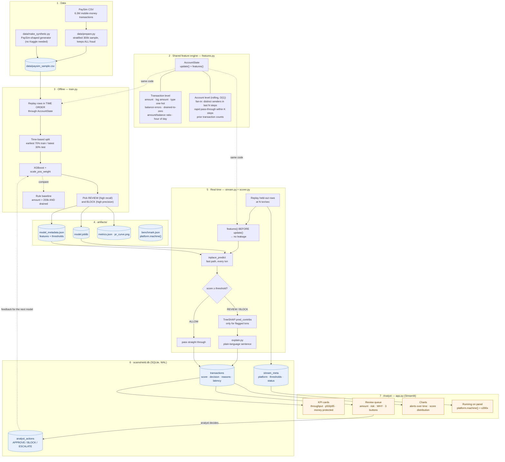
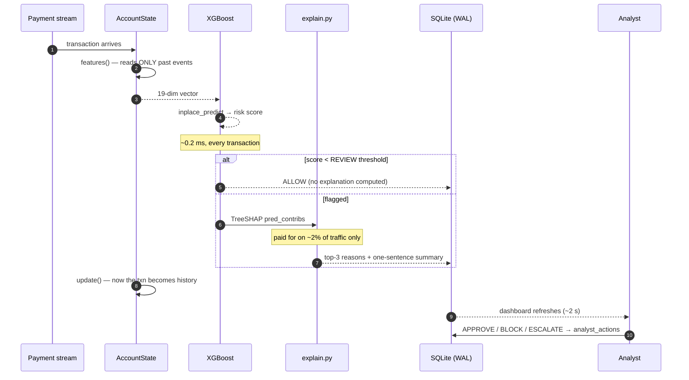
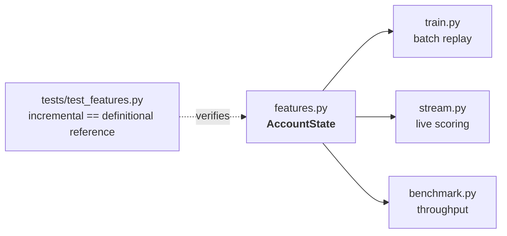
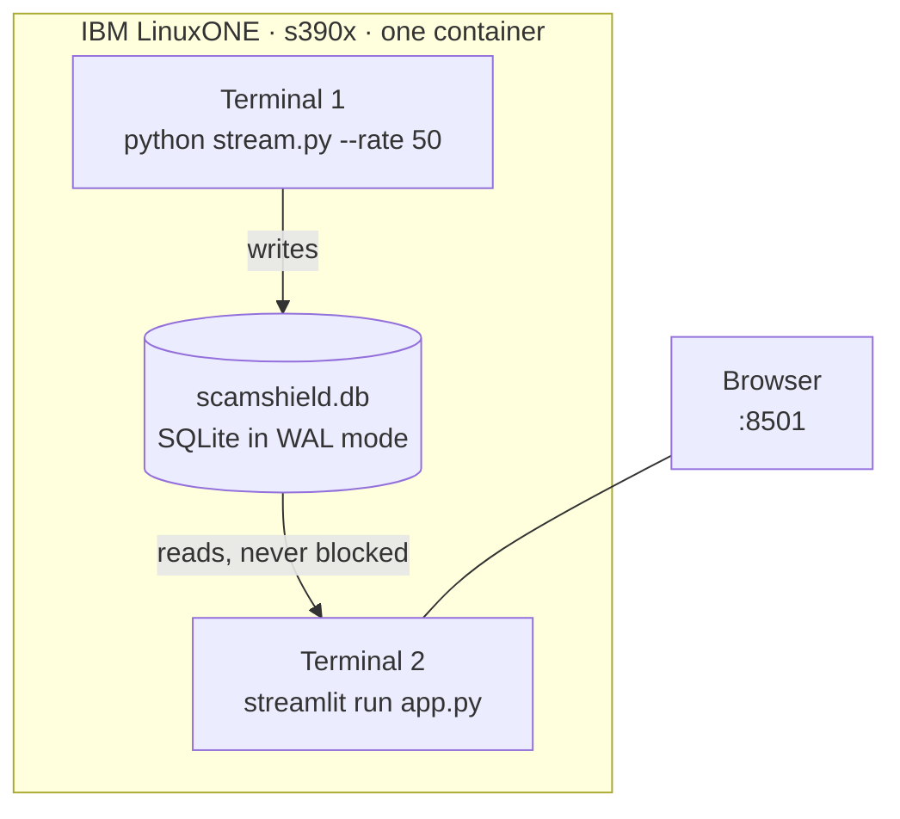

# ScamShield - architecture

## 1. End-to-end flow

## 2. The critical decision path (per transaction)

## 3. Why the feature code is shared

The most common way a fraud model dies in production is **training/serving
skew**: features computed one way in a notebook and another way in the live
system. ScamShield makes that structurally impossible.

There is exactly one implementation. `train.py` replays historical rows
through it in time order; `stream.py` feeds it live transactions. The test
suite re-derives every account-level feature with a naive O(n²) scan over raw
history and asserts the O(1) streaming version produces identical numbers.

## 4. Leakage controls

| Risk | Control |
|---|---|
| Future data in training | Time-based split; train on earliest 70% of steps, test on the rest. Never `train_test_split(shuffle=True)`. |
| A transaction seeing itself | `features(txn)` is called **before** `update(txn)`, always. Enforced by `AccountState.process()` and tested by `test_no_lookahead_future_rows_cannot_change_the_past`. |
| Label leaking through a column | `isFlaggedFraud` (the bank's own legacy rule) is excluded from the feature set. |
| Cold-start mismatch | `stream.py` warms `AccountState` on the training rows first, so live features have the same account history the model trained with. |

## 5. Runtime shape on IBM LinuxONE

Two processes, one file, no message broker and no database server. WAL mode
is what makes the single file safe for a concurrent writer and reader — which
is why the dashboard stays live while the engine is at full throughput.
